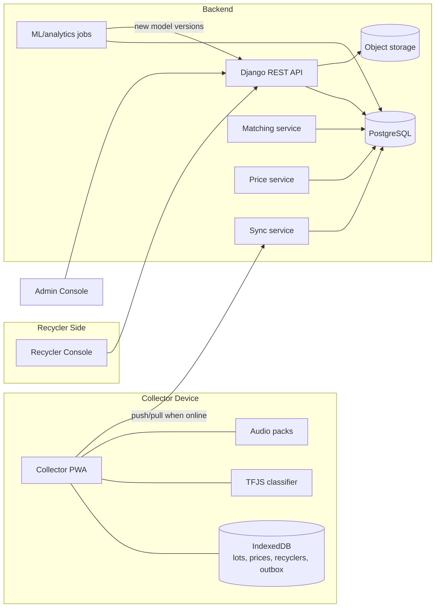
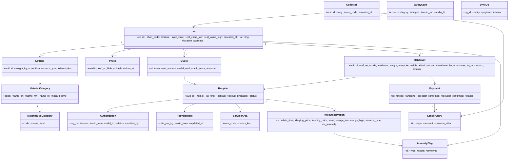
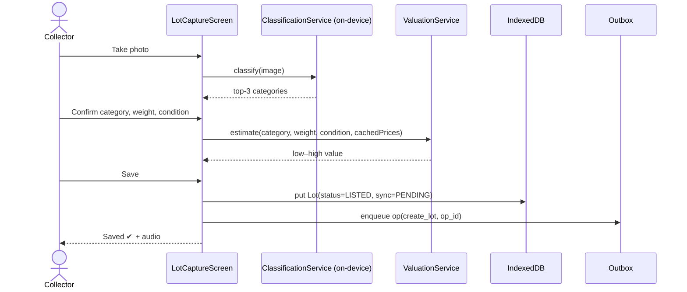
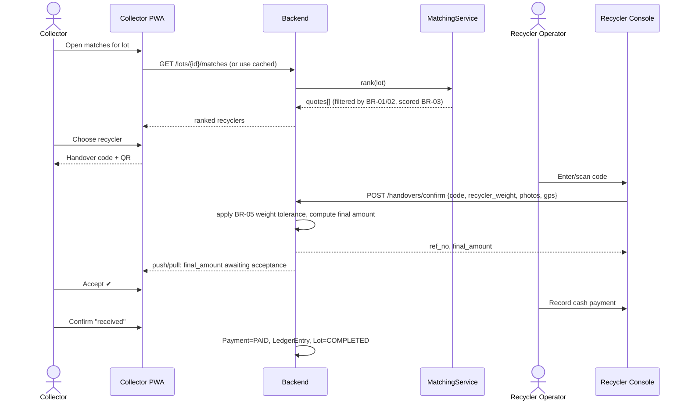
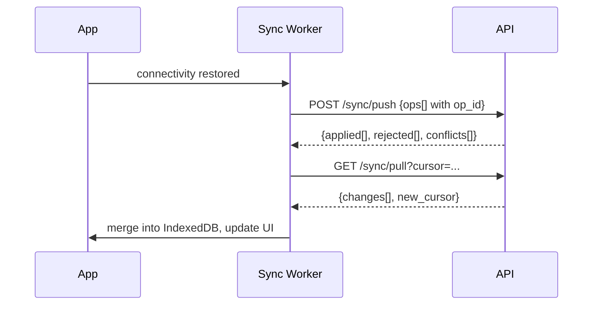
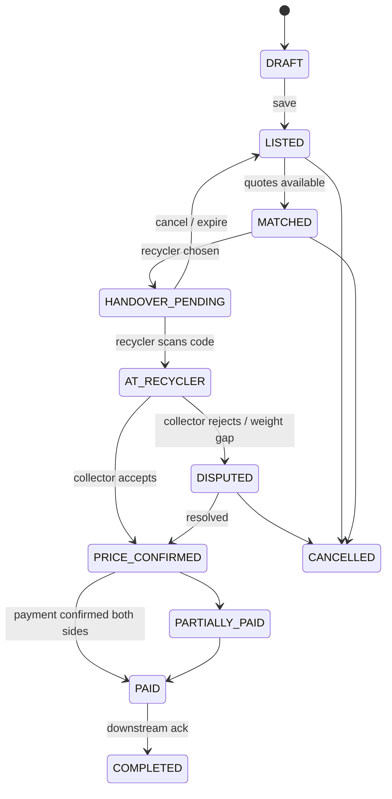

# architecture.md — ScrapSetu
> Covers workflow steps 8–11: Domain Model → BCE/Classes → Sequence → State Model → HLD.
> Update this file whenever the schema, API, or folder structure changes.

---

## 1. Tech Stack

| Layer | Choice | Why |
|---|---|---|
| Collector app | **React + TypeScript + Vite, built as an offline-first PWA** (optional Capacitor wrap into an APK) | Small bundle, no app-store friction, works on entry-level Android, fits the React requirement |
| Local storage | IndexedDB via **Dexie** | Structured offline data + outbox queue |
| Offline | Workbox service worker (precache app shell, runtime cache for audio/images) | Reliable offline shell |
| i18n | **i18next** (`mr`, `hi`, `en` fallback) | Standard, lazy-loaded language packs |
| Audio | Pre-recorded clip packs (numbers, materials, phrases) played via HTMLAudioElement; Web Speech API TTS only as a fallback | Works offline on low-end devices; better quality in Marathi/Hindi than device TTS |
| On-device ML | **TensorFlow.js** (or ONNX Runtime Web) with int8-quantized MobileNetV3-small / EfficientNet-Lite0, lazy-loaded | ≤ 5 MB, offline classification |
| Recycler/Admin console | React + TypeScript + Vite (desktop web) | Shared code with collector app |
| Backend | **Django + Django REST Framework** | Fast to build, ORM, admin, auth |
| Database | **PostgreSQL** (+ PostGIS if time allows; otherwise Haversine in Python/SQL) | Geo queries, relational integrity |
| Async jobs | Celery + Redis *(or Django-Q / cron for MVP)* | Sync processing, retraining, price aggregation |
| Object storage | S3-compatible (MinIO for dev) | Photos |
| ML (server) | scikit-learn, pandas; LightGBM optional; PyTorch/TF only for classifier training | Anomaly, trend, valuation |
| Auth | JWT (SimpleJWT), device-bound collector token + 4-digit PIN; recycler/admin email/phone + password | Low friction for collectors |
| Deploy | Docker Compose; single VM/free-tier cloud for demo | Simplicity |
| Testing | pytest + DRF test client; Vitest + Testing Library; Playwright (recycler console); Lighthouse (PWA) | |

---

## 2. System Overview (HLD)



---

## 3. Domain Model



### 3.1 BCE Mapping

| Boundary (UI/API edge) | Control (logic) | Entity (data) |
|---|---|---|
| `OnboardingScreen` | `CollectorController` | Collector |
| `LotCaptureScreen`, `LotDetailScreen` | `LotController`, `ClassificationService`, `ValuationService` | Lot, LotItem, Photo, MaterialCategory |
| `PriceBoardScreen`, `TrendView` | `PriceBoardService`, `TrendService`, `AudioService` | PriceObservation |
| `MatchListScreen` | `MatchingService`, `RankingPolicy` | Recycler, Authorization, RecyclerRate, ServiceArea, Quote |
| `HandoverScreen`, `RecyclerIntakeScreen` | `HandoverController`, `IntegrityService` | Handover, Photo |
| `PaymentScreen`, `LedgerScreen` | `PaymentController`, `LedgerService` | Payment, LedgerEntry |
| `SafetyScreen` | `SafetyContentService` | SafetyCard |
| Sync API (`/sync/*`) | `SyncService`, `ConflictResolver` | SyncOp |
| Admin queue | `AnomalyService`, `RecyclerVerificationService` | AnomalyFlag, Authorization |
| Recycler console pages | `RecyclerProfileController`, `RateController` | Recycler, RecyclerRate |

**Rule:** Boundary never touches DB directly; Controllers hold business rules (BR-xx); Entities are dumb models + invariants.

---

## 4. Sequence Diagrams

### 4.1 Create lot (offline)


### 4.2 Match and handover


### 4.3 Sync


---

## 5. State Models

### 5.1 Lot


### 5.2 Payment
`PENDING → RECYCLER_MARKED_PAID → COLLECTOR_CONFIRMED (=PAID)`; or `→ DISPUTED`; `PARTIAL` allowed, remainder as pending due.

### 5.3 Recycler authorization
`SUBMITTED → UNDER_REVIEW → ACTIVE → EXPIRING (30 d) → EXPIRED`; also `SUSPENDED`, `REJECTED`.

### 5.4 Sync state (client only)
`LOCAL_ONLY → PENDING → SYNCED`; `CONFLICT → RESOLVED`.

### 5.5 Traceability (post-handover)
`RECEIVED → SORTED → DISPATCHED_TO_PROCESSOR → PROCESSED` (recycler updates; optional for MVP).

---

## 6. Datasets (schemas & lifecycle)

Design principle: datasets are **living**: generated by app operations, validated at capture and server, versioned, and used by features and models.

### 6.1 Seed taxonomy (`MaterialCategory` → sub-categories)
CRT (TV / monitor) · LCD/LED panel · PCB (high-grade / mid / low) · Cables & wires (copper, mixed) · Batteries (Li-ion, lead-acid, other) · Motors & magnet assemblies (HDD, fan, compressor small) · Mixed plastics (ABS casing, etc.) · Metal frames · Others.

### 6.2 Tables (Django models → Postgres)

**Material dataset** (`lot_items`): id, lot_id, category, sub_category, description, image_ref, weight_kg, condition (`WORKING|BROKEN|DISMANTLED|MIXED`), source_type (`HOUSEHOLD|SHOP|OFFICE|OTHER`), est_value_low/high.

**Price dataset** (`price_observations`): id, category, sub_category, area_code, observed_at, buying_price, selling_price, unit (`KG|PIECE`), range_low, range_high, source_type (`RECYCLER|COLLECTOR|ADMIN`), recycler_id (nullable), is_anomaly, verified.

**Recycler dataset** (`recyclers`, `authorizations`, `recycler_rates`, `service_areas`, `recycler_materials`): name, lat/lng, contact, pickup_available, materials accepted, reg_no, issuer, valid_to, status, rate per category, radius/area codes.

**Transaction dataset** (`lots`, `handovers`, `payments`): lot_id, collector_id, category, weight, quoted_price, final_price, recycler_id, collection lat/lng (coarse), handover lat/lng, timestamps, payment_status, transaction_status.

**Traceability dataset** (`handovers`, `photos`, `trace_events`): lot_id, photo refs, weight, timestamp, GPS, ref_no, recycler_confirmation, integrity hash, downstream status events.

**Collector dataset** (`collectors`): id (random UUID), language, area_code (village/ward level), created_at; history via relations. **No name, no Aadhaar.** Phone optional for recovery, stored hashed.

**ML training dataset** (`ml/datasets/`): `images/` (folder per class) + `labels.csv` (image, category, source, verified_by, split); `prices.parquet`; `transactions_anon.parquet`. Every dataset has a `DATASET_CARD.md`: source, size, quality, class balance, limitations.

### 6.3 Data lifecycle
1. **Generate**: app capture, recycler rate posts, handovers, field photos, admin seeds; synthetic price data (clearly labelled `synthetic=true`) only for cold start.
2. **Validate at capture** (client): schema (zod), weight range, category required, image size.
3. **Validate on server**: DRF serializers, business rules, outlier check (robust z-score / IQR per category+area).
4. **Clean/enrich**: dedupe (photo pHash), unit normalization to ₹/kg, geo → area_code.
5. **Anonymize**: drop IDs to salted hashes, coarsen location to ~1 km grid, remove EXIF.
6. **Store**: Postgres + object storage; nightly snapshot; versioned exports (`v2026.09.28`).
7. **Use**: price board (rolling median), trend, valuation, matching, anomaly detection, model retraining.
8. **Update**: weekly aggregation job, feedback labels from user corrections and admin review.

---

## 7. Intelligence (AI/ML) — with fallbacks

| Feature | MVP approach | ML upgrade | Data needed |
|---|---|---|---|
| Material classification | On-device image classifier (MobileNetV3-small/EfficientNet-Lite0, int8) with top-3 suggestions; user always confirms; manual pictorial picker as fallback | Fine-tune as more corrected labels arrive | Field photos: aim ≥ 150–300 per class; verify licenses if using public datasets |
| Valuation | `weight × median_rate × condition_factor` → range | Gradient boosting on transactions once ≥ ~500 rows | Transactions + prices |
| Recycler matching | Hard filters + weighted score (explainable) | Learn-to-rank / preference weights from choices | Choice logs |
| Anomaly detection | Robust z-score / IQR on ₹/kg; weight-mismatch rule; duplicate-photo pHash | Isolation Forest per category | Price + txn history |
| Price trend | 7/30-day moving average + slope | Prophet/ARIMA when history is sufficient | Time series |

**Honesty rule:** report dataset size and accuracy on real field photos, not only on public data.

---

## 8. Offline-First & Sync Design

- **Client IDs**: UUIDv4 + short human code (`SS-` + 6 base32 chars) generated on-device.
- **Outbox**: every mutation becomes a `SyncOp {op_id, entity, action, payload, client_ts}` in IndexedDB.
- **Push**: `POST /api/v1/sync/push` — server dedupes by `op_id` (idempotent), validates, applies, returns per-op result.
- **Pull**: `GET /api/v1/sync/pull?cursor=` — returns changed prices, recyclers, quotes, lot/handover/payment status for this collector.
- **Cached reference data**: categories, price board (last N days), recyclers within service radius, audio and safety packs.
- **Conflicts**: BR-20. Server state machine rejects illegal transitions; client shows the resolved state.
- **Offline handover integrity**: handover payload `{lot_id, weights, ts, gps, photo_hashes}` → SHA-256 hash; 6-digit code derived from lot; recycler confirmation attaches its own hash chain (`prev_hash`). On sync, server recomputes and stores hash → tamper-evident (a lightweight audit trail, not a blockchain).
- **Media**: photos compressed client-side (≤ 150 KB, WebP/JPEG); uploaded separately, resumable, on Wi-Fi/low-data preference.
- **Storage guard**: cap cached photos; LRU purge after successful sync.

---

## 9. API Surface (v1, DRF)

| Area | Endpoints |
|---|---|
| Auth | `POST /auth/collector/register`, `POST /auth/token`, `POST /auth/refresh` |
| Reference | `GET /materials/categories`, `GET /areas` |
| Lots | `POST/GET /lots`, `GET /lots/{id}`, `GET /lots/{id}/matches`, `POST /lots/{id}/select-recycler` |
| Prices | `GET /prices/board?area=`, `GET /prices/history?category=&area=`, `POST /prices/report` |
| Recyclers | `GET /recyclers?area=&category=`, `PATCH /recyclers/me`, `PUT /recyclers/me/rates` |
| Handover | `POST /handovers/confirm`, `POST /handovers/{id}/accept`, `POST /handovers/{id}/dispute` |
| Payments | `POST /payments/{handover}/recycler-mark`, `POST /payments/{id}/collector-confirm` |
| Ledger | `GET /ledger` |
| Safety | `GET /safety/cards?lang=` |
| Sync | `POST /sync/push`, `GET /sync/pull` |
| Admin | `POST /admin/recyclers/{id}/verify`, `GET /admin/anomalies`, `GET /admin/datasets/export` |
| Insights | `GET /insights/impact` |

Conventions: versioned (`/api/v1`), typed error codes (`{code, message_key}`), pagination on lists, all writes idempotent via `op_id`.

---

## 10. Folder & File Structure

```
scrapsetu/
├─ AGENTS.md                  # Agent operating guide and doc routing
├─ memory.md                  # Living log and project status
├─ rules.md                   # Strict guardrails and coding standards
├─ phases.md                  # Project phases and exit criteria
├─ design.md                  # Design system tokens, UX, audio specifications
├─ architecture.md            # Tech stack, domain model, state machines, APIs
├─ PRD.md                     # Requirements, BRs, ACs, traceability matrix
├─ backend/                   # Django project
│  ├─ manage.py
│  ├─ config/                 # settings (base/dev/prod), urls, celery
│  └─ apps/
│     ├─ accounts/            # collector, recycler, admin users, auth
│     ├─ materials/           # categories, sub-categories, seed fixtures
│     ├─ pricing/             # PriceObservation, board, trend, anomaly
│     ├─ recyclers/           # Recycler, Authorization, Rate, ServiceArea
│     ├─ lots/                # Lot, LotItem, Photo, valuation
│     ├─ matching/            # ranking policy, services
│     ├─ handovers/           # Handover, integrity, disputes
│     ├─ payments/            # Payment, LedgerEntry
│     ├─ safety/              # SafetyCard
│     ├─ sync/                # push/pull, SyncOp, conflict resolver
│     ├─ insights/            # impact dashboard, exports
│     └─ common/              # base models, permissions, errors, geo utils
├─ apps/
│  ├─ collector/              # React PWA
│  │  ├─ public/              # manifest, icons, audio packs (mr/, hi/), safety images
│  │  └─ src/
│  │     ├─ app/              # routes, providers
│  │     ├─ features/         # lots, prices, matches, handover, ledger, safety, onboarding
│  │     ├─ db/               # Dexie schema, repositories
│  │     ├─ sync/             # outbox, worker, conflict handling
│  │     ├─ ml/               # tfjs classifier loader, preprocess
│  │     ├─ audio/            # clip player, number-to-audio composer
│  │     ├─ i18n/             # mr.json hi.json en.json
│  │     ├─ ui/               # BigButton, IconTile, AudioButton, WeightStepper…
│  │     └─ sw.ts             # service worker
│  └─ recycler/               # React web console (lots inbox, intake, rates, ledger, export)
├─ packages/
│  └─ shared/                 # TS types, zod schemas, API client, constants
├─ ml/
│  ├─ datasets/               # images/, labels.csv, DATASET_CARD.md
│  ├─ notebooks/
│  ├─ training/               # classifier.py, anomaly.py, trend.py
│  └─ export/                 # tfjs model output
├─ data/
│  ├─ seeds/                  # categories, sample recyclers, synthetic prices
│  └─ field_research/         # interview notes, price logs, consent notes
├─ infra/                     # docker-compose.yml, Dockerfiles, nginx
└─ .env.example
```

---

## 11. Security & Privacy Summary
- HTTPS only; JWT; role-based permissions (collector sees own lots; recycler sees lots assigned to them; admin all).
- PIN stored hashed; optional phone hashed.
- Photos: EXIF stripped; access via signed URLs.
- Audit log for authorization changes, price moderation, handover confirmation.
- Public/exported datasets: anonymized (§6.3).

## 12. Observability
Structured logging, Sentry (optional), sync-failure counters, price-freshness metric, per-phase test reports.
